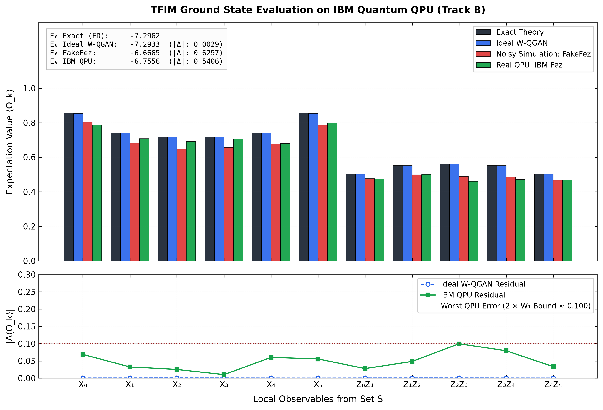

# Quantum Wasserstein GAN (W-QGAN) — Critical TFIM Ground State Synthesis

> **Qiskit Fall Fest 2026 — Challenge 1 | Team QubiTeam**  
> Learning the ground state of the 1D critical Transverse-Field Ising Model (TFIM) via an adversarial Quantum Wasserstein GAN with $\mathbb{Z}_2$ parity-preserving ansatz, barren-plateau mitigation, and real-hardware deployment on IBM Quantum (`ibm_fez`).



---

## Overview

Preparing ground states of critical quantum many-body systems on NISQ devices is challenging due to long-range entanglement and barren plateaus in variational optimization. In this project, we implement and validate a **Quantum Wasserstein GAN (W-QGAN)** that learns the ground state of the 1D critical Transverse-Field Ising Model ($N = 6$, $J = 1.0$, $h = 1.0$, open boundary conditions):

$$H = -J \sum_{i=0}^{N-2} Z_i Z_{i+1} - h \sum_{i=0}^{N-1} X_i$$

### Key Highlights
- **Symmetry-Preserving Generator Ansatz:** Parameterized circuit starting from $H^{\otimes N}$ followed by $L$ layers of $R_{ZZ}$ bond rotations and $R_X$ single-qubit rotations, algebraically preserving $\mathbb{Z}_2$ spin-flip parity ($\langle \Pi \rangle = \langle \bigotimes_i X_i \rangle = +1$).
- **Restricted Wasserstein-1 Critic:** Linear critic over a local observable pool $\mathcal{S} = \{X_i\}_{i=0}^{N-1} \cup \{Z_i Z_{i+1}\}_{i=0}^{N-2}$ with weights projected onto the $\ell_1$-ball ($\|\boldsymbol{\phi}\|_1 \le 0.5$), providing a lower bound on the quantum Wasserstein-1 distance while avoiding global-cost barren plateaus.
- **Exact Parameter-Shift Training & CFT Validation:** Classical adversarial optimization via the parameter-shift rule, verified against exact diagonalization (ED), half-chain entanglement entropy scaling (Conformal Field Theory check), and local vs. global gradient-variance ablation.
- **Real IBM Quantum Hardware Deployment (Track B):** Single-PUB `EstimatorV2` inference on **`ibm_fez`** using `optimization_level=3` transpilation, **TREX** (`resilience_level=1`), and **XY4 Dynamical Decoupling**, benchmarked against ideal statevector and noisy `FakeFez` simulations.

---

## Key Results ($N = 6$ Critical TFIM)

| Metric | Exact (ED) | Ideal W-QGAN ($L=5$) | Noisy `FakeFez` ($L=5$) | Real QPU `ibm_fez` ($L=5$) | Real QPU `ibm_fez` ($L=3$) |
| :--- | :---: | :---: | :---: | :---: | :---: |
| **Ground State Energy ($E_0$)** | `-7.2962` | `-7.2933` | `-6.6665` | `-6.7556` | `-6.8743` |
| **Energy Error ($\|\Delta E_0\|$)** | — | `0.0029` | `0.6297` | `0.5406` | `0.4219` |
| **State Fidelity ($F$)** | `1.00000` | `0.99905` | — | — | — |
| **Half-Chain Entropy ($S$, bits)** | `0.4732` | `0.4753` | — | — | — |
| **Max Observable Error** | — | — | — | `0.0997` | `0.0899` |

Additional verification experiments in the notebook:
- **Parity Conservation:** Verified $\langle \Pi \rangle = +1$ across random parameter samples ($L=5$, 55 parameters, circuit depth 16).
- **CFT Central Charge Scaling:** Half-chain entanglement entropy via exact diagonalization for $N \in \{6, 8, 10, 12, 14\}$ yields an estimated central charge $c = 0.5880$ (theoretical CFT value: $c = 0.5000$).
- **Barren Plateau Ablation:** Gradient variance comparison across $N \in \{4, 6, 8, 10\}$ (2 layers, 200 samples) confirming polynomial vs. exponential scaling between local ($X_0$) and global ($\vert 0\dots 0\rangle\langle 0\dots 0\vert$) cost functions.

---

## Repository Structure

```text
.
├── README.md                                  # Project overview, results, and setup guide
├── requirements.txt                           # Pinned Python and Qiskit dependencies
├── .gitignore                                 # Ignore rules for caches, environments, and secrets
├── code/
│   ├── wqgan_tfim_ground_state.ipynb          # Main implementation, experiments, and QPU evaluation
│   ├── figures/
│   │   └── ibm_qpu_results.png                # Exact vs. Ideal vs. FakeFez vs. ibm_fez comparison plot
│   └── results/
│       ├── track_b_l3_results.npz             # Saved parameters and expectation values (L=3)
│       └── track_b_l5_results.npz             # Saved parameters and expectation values (L=5)
├── presentations/
│   └── qubiteam_presentation.pdf              # Final pitch deck (QubiTeam)
└── assignment/
    ├── Challenge_1_notebook.txt               # Original challenge template/statement export
    └── Guia Qiskit.pdf                        # Qiskit reference guide (Catalan)
```

---

## Getting Started

### 1. Clone and create a virtual environment

```bash
git clone https://github.com/efernaca/Qiskit-Fall-Fest-Challenge-2026.git
cd Qiskit-Fall-Fest-Challenge-2026

python -m venv .venv
# Windows (PowerShell):
.venv\Scripts\Activate.ps1
# Linux / macOS:
# source .venv/bin/activate

pip install -r requirements.txt
```

### 2. Run the notebook

Launch Jupyter and open [`code/wqgan_tfim_ground_state.ipynb`](code/wqgan_tfim_ground_state.ipynb):

```bash
jupyter lab code/wqgan_tfim_ground_state.ipynb
```

> **Note on IBM Quantum Hardware (Track B):** Never hardcode your API token inside the notebook. Save your credentials locally once before running the real-QPU cell:
> ```python
> from qiskit_ibm_runtime import QiskitRuntimeService
> QiskitRuntimeService.save_account(channel="ibm_quantum_platform", token="YOUR_IBM_QUANTUM_TOKEN")
> ```
> Pre-computed hardware results are already stored in `code/results/track_b_l3_results.npz` and `code/results/track_b_l5_results.npz`.

---

## Presentation & Team

- **Slide Deck:** [`presentations/qubiteam_presentation.pdf`](presentations/qubiteam_presentation.pdf)
- **Team QubiTeam:** Iuri, Nil, Èric, Ulises, and Ladislau
